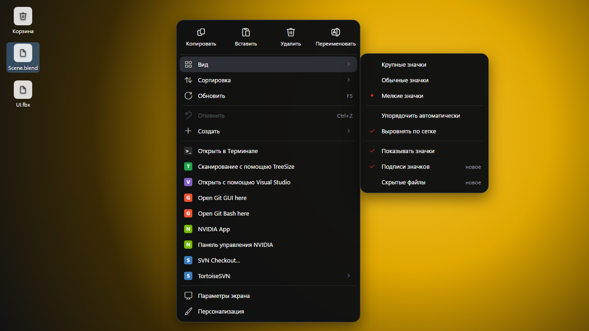
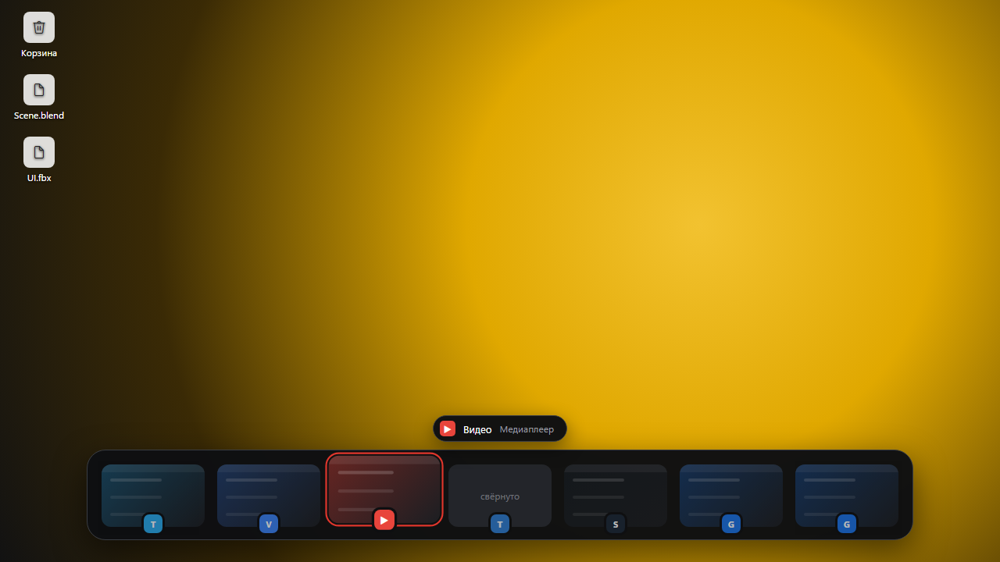
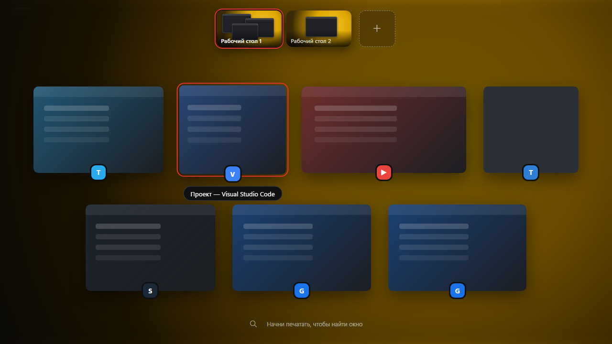
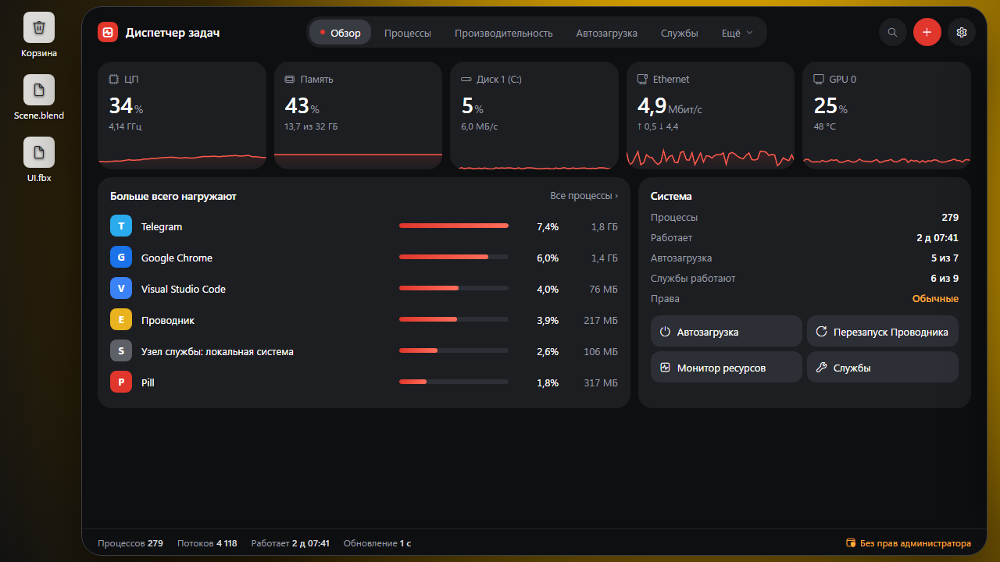

# DeskPill — модуль Pill

Готовые сборки модуля DeskPill для [Pill](https://github.com/lMariksl/Pill-releases). Ставится из Pill: «Управление → Модули → Доступные модули».

- **Меню правой кнопки на рабочем столе** — все пункты Windows и ваших программ, сверху «Копировать / Вставить / Удалить / Переименовать».
- **Alt+Tab** — компактная полоса с живыми миниатюрами окон (снизу, сверху или по центру).
- **Win+Tab** — окна разлетаются в раскладку, рабочие столы сверху, поиск.
- **Диспетчер задач** (Ctrl+Shift+Esc) — новый или классический вид.

